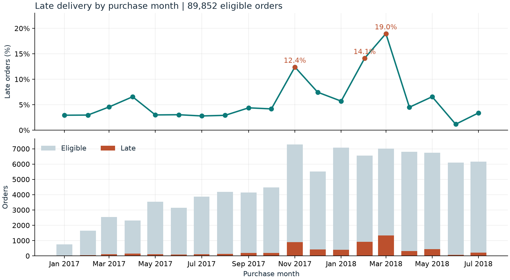
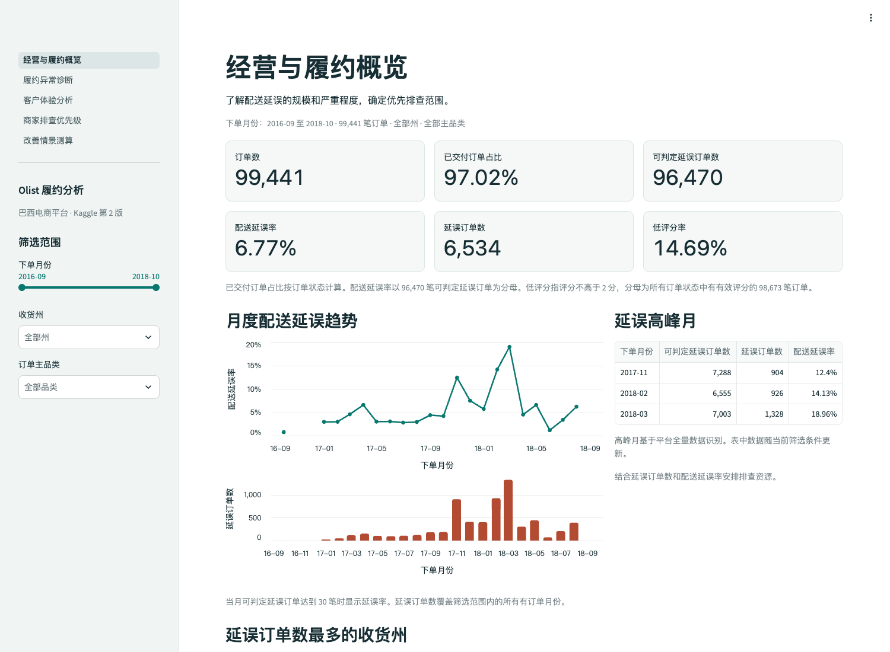

# 电商平台履约异常诊断与运营优化优先级分析

*Marketplace Delivery Performance & Operational Prioritization*

运营团队能排查的订单和线路有限，应先查哪里？本项目用巴西 Olist 电商订单定位延误高峰与重点地区，分析延误与低评分的关联，并筛选应优先排查的商家。

[业务报告（PDF）](reports/business_report.pdf) · [报告源文件](reports/business_report.md) · [商家排查名单](reports/seller_prioritization.md)

## 数据来源与分析方法

Olist 数据集第 2 版（归档版本 ID `2669146`）包含 **2016-09-04 至 2018-10-17 的 99,441 笔订单**。主要月度趋势和调整模型使用 **2017 年 1 月至 2018 年 7 月**的下单样本。快照记录了 9 份 CSV 的文件指纹。 [Kaggle 官方数据集](https://www.kaggle.com/datasets/olistbr/brazilian-ecommerce/versions/2) · [数据快照说明](data/snapshot.json)

- 用 SQL 和 DuckDB 处理商品、支付和评价的一对多关系，构建订单和订单—商家事实表。延误率只统计已交付且签收日和承诺日可比较的订单，实际签收日晚于承诺日即为延误。每笔订单按一个主品类统计。
- 用 Python 拟合 Logistic Regression，估计延误与低评分（评分 ≤2）的关联。基于单商家订单计算商家评分，再通过跨期比较和同行对照确定排查顺序。

[指标口径](reports/data_dictionary.md) · [数据质量检查](reports/data_quality_report.md)

## 主要发现与运营建议

| 主要发现 | 运营建议 |
| --- | --- |
| **96,470 笔可判定延误订单中，6,534 笔延误，延误率为 6.77%**。2017 年 11 月、2018 年 2 月和 3 月的延误率分别为 **12.40%、14.13%、18.96%**。这三个月合计占成熟观察期延误订单的 **51.45%**。 | 复盘 11 月下旬的运力和交接情况，并重点检查 2–3 月运输耗时特别长的订单。 |
| SP 州有 **1,820 笔**延误，RJ 州有 **1,495 笔**延误，延误率为 **12.11%**。按期订单运输耗时中位数为 **6.95 天**，延误订单为 **26.20 天**。 | 优先排查 RJ 订单量较大的线路，持续跟踪 SP 的延误规模。结合承运记录核实责任环节。 |
| 在有有效评分的订单中，延误组与按期组的低评分率分别为 **62.42%** 和 **9.27%**。控制下单月份、收货州及订单主品类后，调整优势比（OR）为 **15.44**，95% 置信区间为 **14.52–16.41**。 | 对可能延误的订单试行提前跟踪与客户沟通，通过试点评估实际效果。 |
| 在 2017 年和 2018 年 1–7 月均至少有 **50 笔**可判定延误订单的 **96 家**商家中，两期评分的斯皮尔曼秩相关系数为 **ρ = 0.371**，两期前十名仅重合 **2 家**。 | 优先排查 **21 家**商家。筛选条件为两期平滑超额延误均为正、验证期同行对照覆盖率 **≥70%**，且在相同收货州与订单主品类下，实际延误高于同行预期。 |
| 这 21 家商家在 2018 年 2–3 月有 **1,522 笔**可判定延误订单，其中 **366 笔**延误。订单量和样本构成固定时，延误率相对下降 **10%** 或 **20%**，预计分别减少 **36.6 笔**或 **73.2 笔**延误。 | 以估算结果设定试点目标，在后续可比高峰期验证实际改善幅度。 |



## 交互式分析看板

概览和履约诊断按下单月份、收货州和订单主品类联动筛选。客户体验、商家排查和改善情景各用固定样本。情景滑块可调整延误率的相对降幅（0%–30%）。

[](figures/dashboard_overview.png)

[履约异常诊断](figures/dashboard_delivery.png) · [客户体验分析](figures/dashboard_experience.png) · [商家排查优先级](figures/dashboard_sellers.png) · [改善情景测算](figures/dashboard_scenarios.png)

## 项目结构

| 目录 | 内容 |
| --- | --- |
| `sql/`、`src/` | DuckDB 事实表建模、数据检查、统计分析和结果导出 |
| `analysis/` | 数据核验、履约诊断和商家优先级分析 SQL |
| `dashboard/` | 五页 Streamlit 分析看板 |
| `tests/`、`scripts/` | 模型测试、浏览器验收和 PDF 导出 |
| `data/` | 数据来源、版本指纹及本地数据目录 |
| `figures/`、`reports/` | 分析图表、界面截图、正式报告、商家名单和验收记录 |

## 本地复现

已在 Apple Silicon macOS 和 Python 3.14 环境验证。请在项目根目录运行。

```bash
python3.14 -m venv .venv
.venv/bin/python -m pip install -r requirements.txt
make analysis
.venv/bin/streamlit run dashboard/app.py
```

`make analysis` 校验数据指纹、构建 DuckDB、运行模型测试，并将分析表写入 `data/processed/analysis/`。Streamlit 读取并缓存本地结果。已有官方 ZIP 时，可先用 `.venv/bin/python -m src.fetch_data --archive ~/Downloads/brazilian-ecommerce.zip` 导入。 [数据准备说明](data/README.md)

浏览器验收和 PDF 导出需要可选依赖及 Google Chrome。导出 PDF 还需 Pandoc 和苹方、思源黑体等系统字体。验收期间请保持 Streamlit 在默认本地端口运行。

```bash
.venv/bin/python -m pip install -r requirements-delivery.txt
.venv/bin/python scripts/check_dashboard.py
.venv/bin/python scripts/render_report.py
```

## 局限性

数据缺少详细承运事件和明确的抽取截止日期，限制了对延误原因的判断和对快照末端月份的比较。延误组与按期组的评分覆盖率不同，调整 OR 反映的是历史关联。商家名单基于历史样本，仍需在新的高峰期验证。情景估算假设订单量和样本构成固定，实际成效需通过试点衡量。

[分析证据](reports/analysis_findings.md) · [交付验收记录](reports/release_validation.md)
