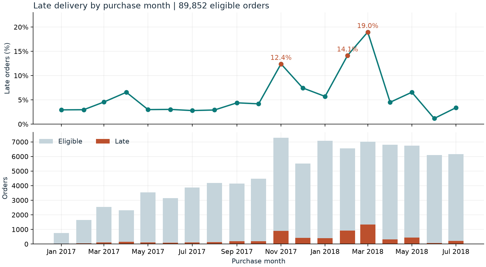
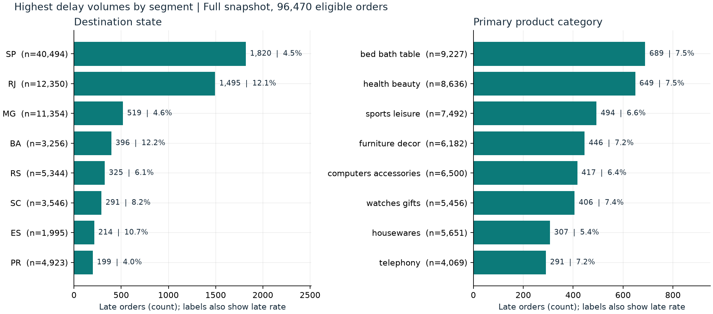
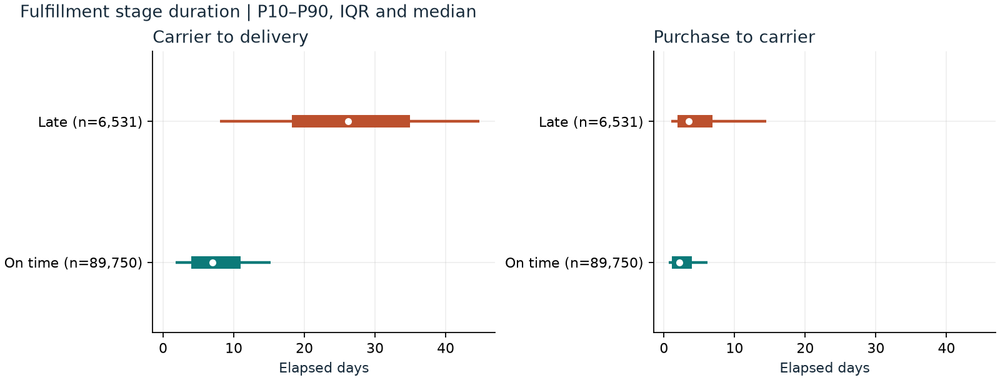
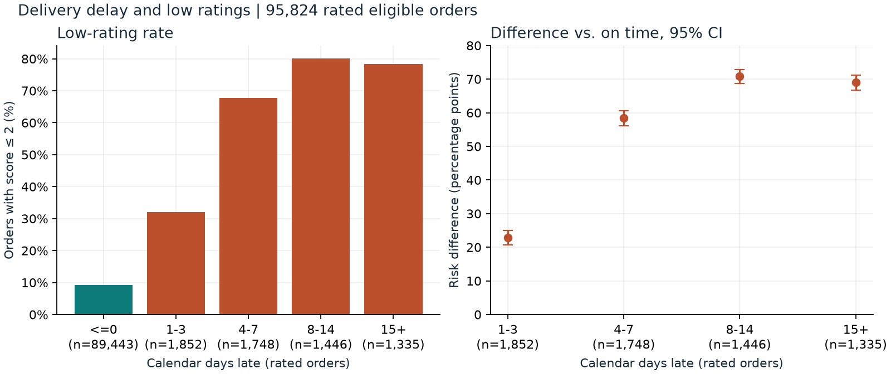
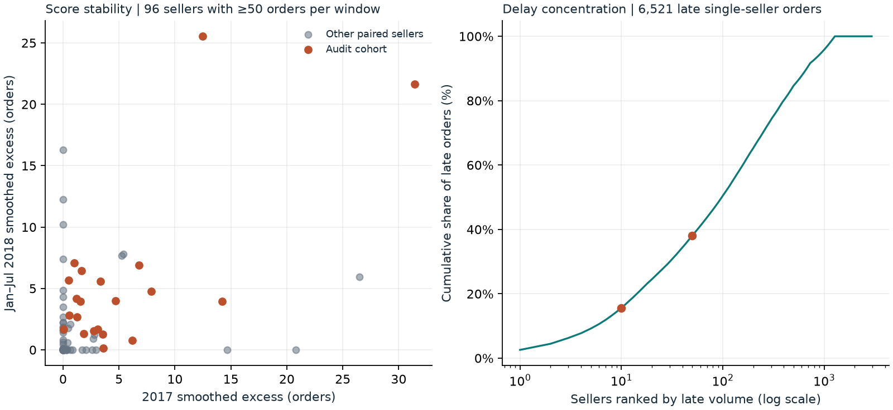

# 执行摘要

**运营决策。** 当排查资源有限时，先复盘高峰月份的目的州线路与运输节点，在 21 家历史筛选商家群中抽查订单，再依据新增高峰数据决定是否扩大范围。

| 规模 | 高峰集中度 | 客户体验 |
| --- | --- | --- |
| 96,470 笔订单可判配送延误 | 三个高峰月贡献成熟窗口 51.45% 的延误 | 延误组 62.42% 的有效评价为低评分 |
| 6,534 笔延误，整体延误率 6.77% | 2018 年 3 月延误率 18.96% | 按期组低评分率 9.27% |

## 建议排查顺序

1. **先查 RJ 高峰线路。** RJ 全期延误 1,495 笔、延误率 12.11%，在三个高峰月均为州内超额延误最多的目的地。并行观察 SP 的 1,820 笔延误，防止高量问题被平均率掩盖。
2. **先核对运输记录，再按月份补查交接。** 延误订单运输中位数为 26.20 天，按期为 6.95 天。2017 年 11 月交接时间也拉长，应同步调取交接、揽收和承运事件。
3. **用 21 家商家群做高峰期复盘。** 两期前十仅重合两家。以同行差额安排抽查顺序，并按目的州和主品类找同类订单。高峰样本中该群体有 366/1,522 笔延误。
4. **量化试点目标。** 如果同类高峰样本的延误率相对下降 10% 或 20%，预计分别少 36.6 笔或 73.2 笔延误。先确定覆盖线路与订单，再验证可实现的改善幅度。

**决策边界。** 履约指标描述历史订单。评分回归衡量统计关联，商家名单用于回顾性筛选，改善量来自条件情景。运营试点的实际效果需要单独测量。

# 数据与分析口径

数据来自 [Kaggle Olist Brazilian E-Commerce Public Dataset v2](https://www.kaggle.com/datasets/olistbr/brazilian-ecommerce/versions/2)，归档版本 ID 为 2669146。全快照下单日期为 **2016-09-04 至 2018-10-17**。订单、商品、商家、支付与评价等九张表经指纹验证后进入 DuckDB。

| 观察样本 | 按下单日期 | 使用场景 |
| --- | --- | --- |
| 全快照 | 2016-09-04 至 2018-10-17 | 99,441 笔订单，96,470 笔可判延误。平台、州和品类概况 |
| 成熟窗口 | 2017-01 至 2018-07 | 89,852 笔可判延误。趋势、高峰和主回归 |
| 商家早期 / 后期 | 2017-01 至 2017-12 / 2018-01 至 2018-07 | 各窗口独立排序，仅纳入可判延误的单卖家订单 |
| 情景主样本 | 2018-02 至 2018-03 | 21 家回顾性筛选商家的 1,522 笔可判订单 |

## 业务指标

- **配送延误。** 限状态已送达且下单、预计送达、实际签收时间有效的订单。实际签收日超过预计送达日记为延误，同日签收计按期。按合格订单数计算延误率。
- **阶段耗时。** 下单至交接承运方、交接至签收均按经过时间换算成天，对比使用相同的 96,281 笔时间完整且先后顺序有效的订单。
- **低评分。** 有有效评价时取评分 ≤2。评价按最新答复时间及固定的并列处理规则选出一条。全平台交付概览与可判延误评价样本分别标示分母。
- **区域与主品类。** 地区采用目的州。以商品行数最多的品类定义互斥主品类，同数时按葡语键排序。

## 对账

订单事实表 99,441 行，订单—商家事实表 100,010 行，与原始预期键数一致。商品、支付和评价先在各自粒度汇总或选定，再接入订单层。8 笔状态已送达的订单缺签收时间，从延误分母排除。地理表的邮编是一对多关系，州分析沿用原始客户州字段。原始金额、延误、商家分数和评价结果均已复算。

# 履约异常诊断

## 三个高峰月

2017 年 11 月、2018 年 2 月和 3 月占成熟窗口可判订单的 **23.2%**，贡献 **51.45%** 的延误。2018 年 4 月回落至 4.50%，6 月为 1.16%。

| 下单月 | 延误 / 可判 | 延误率 | 保持当月州组合的参考延误量 |
| --- | ---: | ---: | ---: |
| 2017-11 | 904 / 7,288 | 12.40% | 约 315 笔 |
| 2018-02 | 926 / 6,555 | 14.13% | 约 283 笔 |
| 2018-03 | 1,328 / 7,003 | 18.96% | 约 297 笔 |
| 其余成熟月份 | 2,980 / 69,006 | 4.32% | 基准 |

参考量将高峰月各州可判订单数乘其余成熟月份该州的延误率再加总。RJ 在三个高峰的州内超额延误均最多。3 月的 SP 与 MG 也分别比参考量多约 191 与 154 笔。

**优先核对的日期。** 11 月 22–28 日有 570 笔延误，占该月 63.1%。2 月下半月持续上升，22–28 日达到 23.10%，3 月 1–7 日继续升至 27.23%。先对齐这些下单队列与承运事件日期，再查当期计划运力与承诺规则。

# 地区、品类与履约阶段

**先看量率组合。** SP 有 1,820 笔延误，延误率为 4.49%，适合优先监控总负荷。RJ 同时具备较高延误量和延误率（1,495 笔，12.11%），优先复盘线路。床品桌布浴室用品和美妆健康分别有 689 和 649 笔延误。办公家具率较高（8.12%），延误量为 101 笔。

**重点查运输尾部。** 在按期与延误订单中，运输中位数分别为 **6.95 与 26.20 天**，交接前为 **2.15 与 3.50 天**。2、3 月运输 P90 分别为 26.81 和 28.22 天，其他成熟月份为 17.00 天。3 月承诺中位时长也从其他月份的 24.01 天缩至 21.32 天。11 月交接前中位数为 3.16 天，其他成熟月份为 2.13 天。建议把承诺、揽收和运输事件对齐后分别复盘。

# 客户体验与低评分关联

全快照可判延误且有评价的 **95,824** 笔订单中，延误组低评 **3,983/6,381（62.42%）**，按期组 **8,289/89,443（9.27%）**。绝对风险差 **53.15 个百分点**，95% Newcombe 区间为 **51.94–54.35 个百分点**。

| Logistic 规格 | 样本量 | OR | 95% CI |
| --- | ---: | ---: | ---: |
| 成熟窗口，粗模型 | 89,230 | 16.95 | 16.00–17.95 |
| 成熟窗口，调整下单月、目的州和主品类 | 89,230 | 15.44 | 14.52–16.41 |
| 成熟窗口，调整后按客户聚类 | 89,230 | 15.44 | 14.52–16.41 |
| 成熟单卖家样本，调整后按商家聚类 | 88,084 | 16.44 | 15.17–17.82 |

**运营含义。** 延误 1–3 天的低评率已达 32.13%，4–7 天升至 67.68%，适合测试更早发出的配送异常通知。低评阈值改为 ≤3 或去除三个高峰月，调整 OR 仍为 12.53 或 13.97。延误与按期组评价覆盖为 97.66% 和 99.45%，全部缺评朝相反方向赋值时风险差为 51.19–54.08 个百分点。优势比衡量关联，试点应单独评估主动沟通的实际成效。

# 商家排查优先级

默认要求至少 **50 笔**可判延误的单卖家订单。全期 **415 家**达标，覆盖 75.34% 的单卖家延误。排序以加权基准平滑后的正向超额延误数为主，平滑权重等价于 50 笔基准订单。

| 双窗样本门槛 | 全期候选 | 全期单卖家延误覆盖 | 双窗分数 Spearman ρ | 跨期前十重合 |
| ---: | ---: | ---: | ---: | ---: |
| 30 | 615 | 83.36% | 0.358 | 2/10 |
| 50 | 415 | 75.34% | 0.371 | 2/10 |
| 100 | 201 | 59.94% | 0.386 | 2/10 |

**最终建议排查 21 家高峰商家群。** 要求两期各至少 50 笔、平滑超额延误分数为正。后期同行对照覆盖至少 70%，且覆盖部分实际延误高于同行期望。同行按目的州 × 主品类作留一商家对照。首先复盘 `4869f7a5dfa277a7dca6462dcf3b52b2` 与 `4a3ca9315b744ce9f8e9374361493884`，覆盖样本分别超出同行预期约 18.8 和 12.4 笔。完整名单见商家排查报告。

**聚焦高峰。** 该群 2018 年 2–3 月延误率为 24.05%，其余单卖家为 15.83%。其他后期月份分别为 4.11% 与 4.45%。抽查应结合同行也异常的 RJ 品类与线路，再用承运事件来判断责任。

# 改善情景、行动与验证

主情景固定为 21 家商家在 2018 年 2–3 月下单的 **1,522 笔**可判订单，基线 **366 笔延误（24.05%）**。在订单量、商家与品类组合及承诺口径固定时，期望减少延误等于基线延误量乘相对下降幅度。

| 相对下降 | 情景延误率 | 预计减少（笔） | 预计剩余（笔） |
| ---: | ---: | ---: | ---: |
| 10% | 21.64% | 36.6 | 329.4 |
| 20% | 19.24% | 73.2 | 292.8 |

以上为历史基线上的试点目标。若扩为完整后期窗口，基线为 466/3,955，按同样改善幅度预计减少 46.6 笔或 93.2 笔。两种观察窗分开解读。

## 建议行动

| 优先级 | 建议行动 | 验证标准 |
| --- | --- | --- |
| 1　界定高峰故障 | 调取 RJ 高量品类及头两家商家的揽收和运输事件，按下单日、线路及承运商对齐 11 月末和 2–3 月的异常队列 | 在订单层面核对承诺变化与实际阶段耗时，记录归因证据 |
| 2　试点并追踪 | 在下一次可比高峰选择明确的线路，预先锁定基线和对照。针对运输尾部加预警，必要时协调交接窗口 | 报告延误笔数、率及阶段 P90。保留对照，观察最新订单是否仍未完成 |
| 3　评估体验 | 在试点中单独标记主动沟通触达和评价覆盖 | 以有评订单为分母，同时报告缺评。比较低评风险差与区间 |

## 方法局限

数据缺少完整承运事件与明确抽取截止日，限制了高峰触发原因判断与末端月份比较。商家群以历史两期回顾性筛选，后期同行基准还可能混入月度结构差异，需独立高峰验证。回归控制可观测的月份、州和品类，仍保留未观测混杂。历史情景值用于容量规划，实际成效以试点为准。
